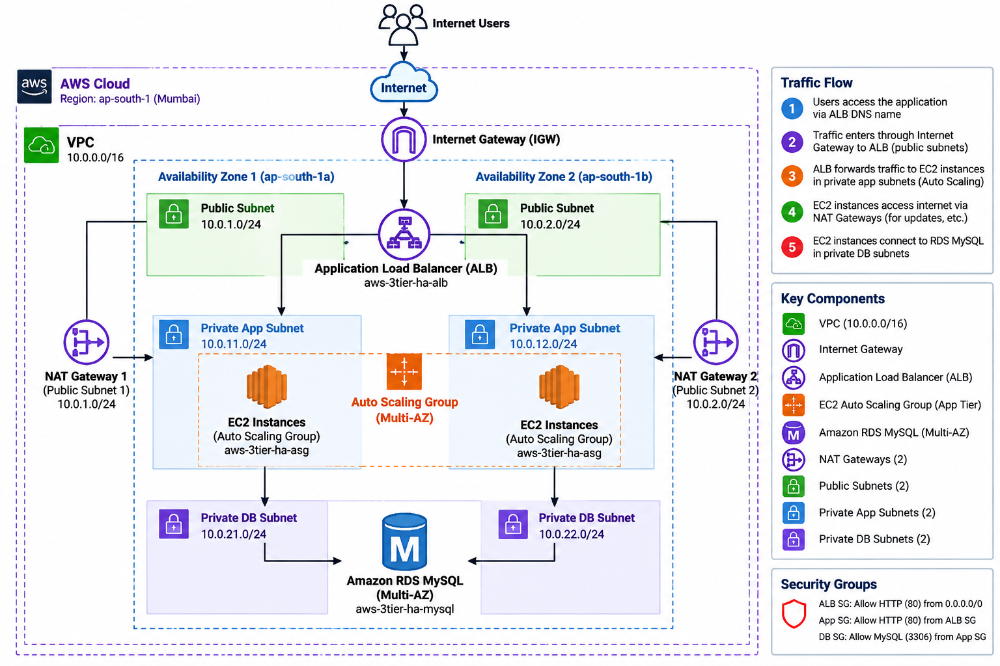

# AWS High-Availability 3-Tier Infrastructure


## 📌 Project Overview

This project demonstrates a highly available 3-tier application infrastructure on AWS, provisioned and managed entirely using Terraform.

The architecture is deployed across two Availability Zones in the AWS Mumbai region (`ap-south-1`) and separates the application into public, private application, and private database tiers.

The infrastructure was designed with high availability, network isolation, controlled access, scalability, and monitoring in mind.

---

## 🏗️ Architecture



### Architecture Components

- Amazon VPC
- Internet Gateway
- 2 Availability Zones
- 2 Public Subnets
- 2 Private Application Subnets
- 2 Private Database Subnets
- Application Load Balancer
- EC2 Auto Scaling Group
- 2 NAT Gateways
- Amazon RDS MySQL
- Security Groups
- IAM Instance Role
- Amazon CloudWatch
- Terraform

---

## 🌐 Network Architecture

### VPC

```text
VPC CIDR: 10.0.0.0/16
Region: ap-south-1 (Mumbai)
Availability Zones: ap-south-1a, ap-south-1b